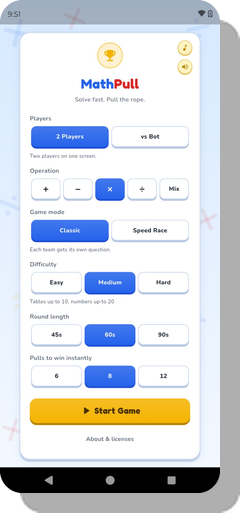
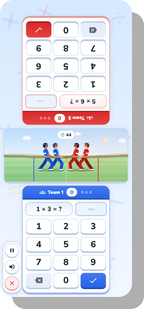
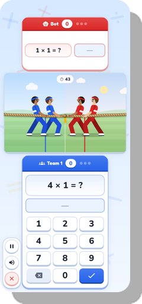
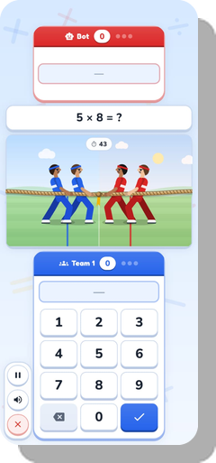
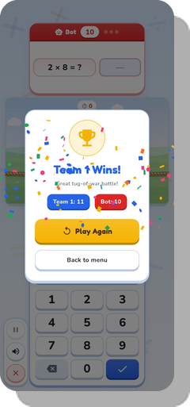

<div align="center">
  

  # MathPull: Maths Tug of War

  **Solve fast. Pull the rope.**

  A free maths tug-of-war game for Android. Two players on one screen, or you vs a bot. Every correct answer pulls the rope your way.

  [](https://play.google.com/store/apps/details?id=com.farooqbuilds.mathpull)
  [](https://flutter.dev)
  [](https://dart.dev)
  [](#copyright)
  [](#tests)
  [](https://play.google.com/store/apps/details?id=com.farooqbuilds.mathpull)

</div>

---

## Screenshots

<div align="center">
  
  
  
  
  
</div>

---

## Download

<a href="https://play.google.com/store/apps/details?id=com.farooqbuilds.mathpull">
  
</a>

> **Free · No ads · No sign-up · Works offline · Ages 6+**

---

## How to play

1. **Pick your rules** — choose 2 Players or vs Bot, the operation, game mode and difficulty
2. **Answer fast** — type the answer on your number pad; every correct answer pulls the rope
3. **Streak bonus** — 3 right answers in a row puts you "on fire"; the next correct answer pulls 2
4. **Win** — pull the rope far enough for an instant win, or lead when time runs out

### Game modes

| Mode | How it works |
|------|-------------|
| **Classic** | Each team gets its own question and answers at its own pace |
| **Speed Race** | Both teams race on the same shared question; first correct answer scores |

### Options

| Option | Choices |
|--------|---------|
| Players | 2 Players (one screen) · vs Bot (Easy / Medium / Hard) |
| Operation | + · − · × · ÷ · Mix |
| Difficulty | Easy · Medium · Hard |
| Round length | 45 s · 60 s · 90 s |
| Pulls to win instantly | 6 · 8 · 12 |

### Layouts

- **Portrait, 2 Players** — players sit face to face; top calculator is upside down
- **Portrait, vs Bot** — bot panel on top, your calculator at the bottom
- **Landscape** — calculators on the sides, arena in the middle
- **Tablet / wide screen** — side-by-side layout with top controls bar

---

## Features

- 🎮 Two game modes: Classic and Speed Race
- 🤖 Single-player vs bot (Easy / Medium / Hard)
- 🔥 Streak bonus system (3 correct → next pulls 2)
- 🏆 Match point banner and win screen with confetti
- 🔔 Optional daily reminder with a week row (Daily Pull)
- 🎵 Original music and sound effects
- 📱 Phone and tablet support (portrait and landscape)
- 🌐 Web build supported (Flutter)
- ✅ No ads · No sign-up · Works offline · No data collected

---

## Project structure

```
lib/
├── main.dart
├── core/
│   ├── constants/        # game rules, layout sizes, all strings
│   ├── layout/           # adaptive layout (ScaledView, BoardMode)
│   ├── reminder/         # daily reminder logic, settings, play log
│   └── services/         # sound_service, music_service, audio_settings
├── game/
│   ├── game_controller.dart   # all round rules and the bot AI
│   ├── tug_of_war_game.dart   # Flame game
│   └── rope_component.dart    # arena, rope, characters
├── models/               # GameSettings, Question generator
├── screens/              # StartScreen, GameScreen, AboutScreen
├── theme/                # AppColors, AppText, AppSpacing, AppRadius
└── widgets/              # TeamPanel, BotPanel, Numpad, ChunkyButton,
                          # WinOverlay, PauseOverlay, DailyPullCard, ...
test/
├── question_test.dart        # question generator
├── bot_test.dart             # bot difficulty and accuracy
├── controller_test.dart      # game rules (streak, match point, timer)
├── play_log_test.dart        # daily play log
├── reminder_logic_test.dart  # reminder scheduling rules
├── reminder_settings_test.dart
├── reminder_manager_test.dart
└── reminder_format_test.dart
assets/
├── audio/sfx/            # original sound effects (.wav)
├── audio/music/          # original music loops (.ogg)
├── google_fonts/         # Fredoka and Nunito (bundled, no network)
└── licenses/             # font license texts (shown in app)
tools/
├── make_audio.py         # generates all audio from code
└── make_icons.py         # generates launcher icon and splash
web/
└── privacy.html          # privacy policy (deployed with the web build)
store/                    # store graphics and README assets
```

---

## Getting started

**Requirements:** Flutter 3.47+, Dart 3.13+, Android SDK 36

```powershell
# Clone
git clone https://github.com/syedfarooqisrar/tug-of-war-math.git
cd tug-of-war-math

# Install dependencies
flutter pub get

# Run on a connected device
flutter run

# Run on Chrome
flutter run -d chrome

# Run release build on device
flutter run --release
```

---

## Tests

```powershell
flutter analyze        # no issues expected
flutter test           # 115 tests, all passing
```

The tests cover the question generator, all game rules (streak, double pull, match point, instant win, Speed Race, timer, pause), the bot AI, and the daily reminder system.

---

## Build for release

```powershell
# Android App Bundle (Play Store)
flutter build appbundle --release

# Android APK (direct install)
flutter build apk --release

# Web
flutter build web --release
```

> ⚠️ The upload keystore (`android/key.properties` and the `.jks` file) is never committed. Keep a backup in a secure location.

---

## Audio

All sound effects and music are original — generated from code, not recorded or sampled.
To regenerate them (requires Python 3, `numpy` and `ffmpeg`):

```powershell
pip install numpy
python tools/make_audio.py
```

This rewrites `assets/audio/sfx/*.wav` and `assets/audio/music/*.ogg`.

---

## Privacy

MathPull collects no personal data. It has no ads, no sign-up and no analytics.
The optional daily reminder is local to the device and uses no network.

→ [Privacy Policy](https://mathpull.pages.dev/privacy.html)

---

## Credits

See [CREDITS.md](CREDITS.md) for the full list of open-source packages and font licenses.
Licenses are also shown inside the app under **About & licenses**.

---

## Releases

| Version | What's new |
|---------|-----------|
| [1.1.0](https://github.com/syedfarooqisrar/tug-of-war-math/releases/tag/v1.1.0) | Daily Pull week row, optional daily reminder, privacy policy update |
| [1.0.0](https://github.com/syedfarooqisrar/tug-of-war-math/releases/tag/v0.15.0) | First public release on Google Play |

---

## Built with

| Tool | Purpose |
|------|---------|
| [Flutter 3.47](https://flutter.dev) + [Dart 3.13](https://dart.dev) | App framework |
| [Flame](https://flame-engine.org) | 2D game engine for the arena |
| [audioplayers](https://pub.dev/packages/audioplayers) | Sound and music |
| [shared_preferences](https://pub.dev/packages/shared_preferences) | Settings persistence |
| [flutter_local_notifications](https://pub.dev/packages/flutter_local_notifications) | Daily reminder |
| [google_fonts](https://pub.dev/packages/google_fonts) | Bundled Fredoka and Nunito fonts |

---

## Copyright

© 2026 FarooqBuilds (doubleOlabs). All rights reserved.

Google Play and the Google Play logo are trademarks of Google LLC.
